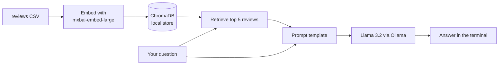

# pizzeria-review-agent

A command-line assistant that answers questions about a pizzeria from its customer reviews, running entirely on your own machine.

It runs on Ollama, a tool that serves open-source language models locally, so no API key or network call is needed after the models are downloaded.

## Problem and approach

This is a small retrieval-augmented generation (RAG) project: look up the passages most relevant to a question, then let the model answer from only those passages. Without the lookup, a model asked about a restaurant invents details.

1. `src/vector.py` reads `data/realistic_restaurant_reviews.csv` with pandas and joins each review's title and text.
2. It embeds each review with `mxbai-embed-large` (an open embedding model) through Ollama and stores the vectors in ChromaDB, a local vector database, under `chrome_langchain_db/`. It builds the database on the first run and reuses it after that.
3. `src/main.py` takes your question, retrieves the 5 closest reviews, and passes them with the question to Llama 3.2 (Meta's open model) through a LangChain prompt.

## Architecture



## Results

This repo has no measured results. It demonstrates a local RAG loop with a persistent vector store. I have not tested answer accuracy against the reviews, so I do not report numbers.

## Run it

Install Ollama from https://ollama.com/download, then pull both models.

```powershell
ollama pull llama3.2
ollama pull mxbai-embed-large
git clone https://github.com/unusual9guy/pizzeria-review-agent.git
cd pizzeria-review-agent
python -m venv .venv
.venv\Scripts\Activate.ps1
pip install -r requirements.txt
python src/main.py
```

Run it from the repo root, because the CSV path is relative. Type a question at the prompt and `q` to quit. Example: "What do customers say about the crust?"

The project reads no environment variables.

## Limitations and next steps

- The number of retrieved reviews is fixed at 5. A question about the whole review set ("what is the average rating?") cannot be answered from 5 reviews. The ratings are stored as metadata but never used.
- The answer does not say which reviews it used.
- There is no evaluation set. A small golden set of questions with expected reviews would show whether retrieval works.
- TODO: state where `data/realistic_restaurant_reviews.csv` comes from.

## Screenshot

TODO: add a terminal screenshot or GIF of a question and answer.
